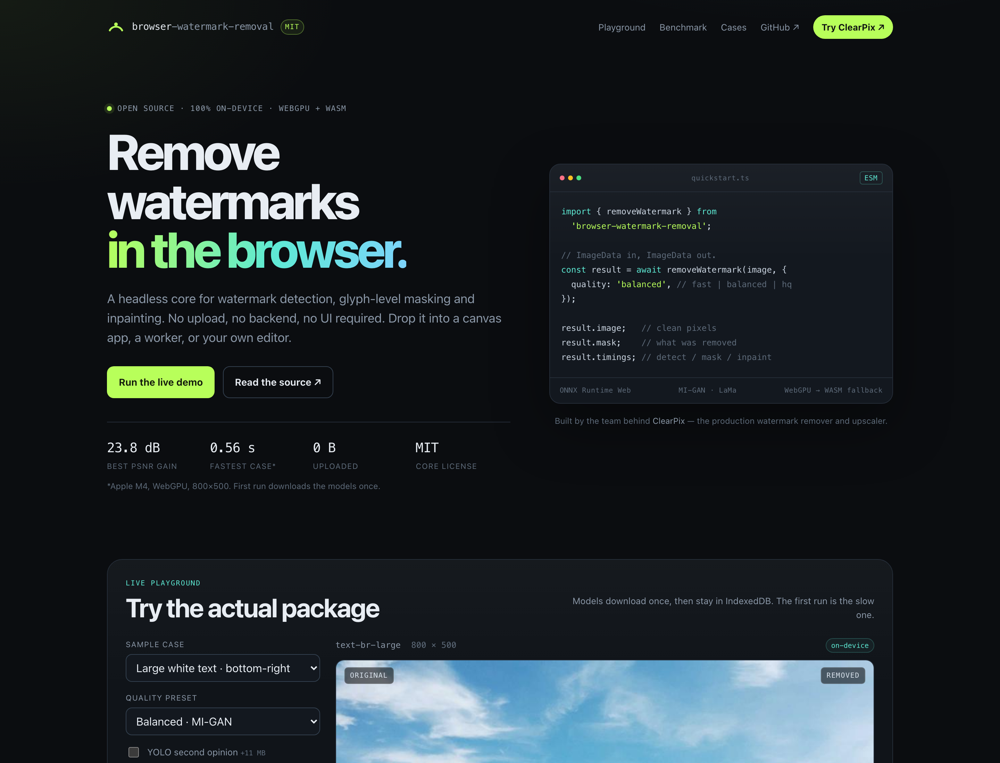
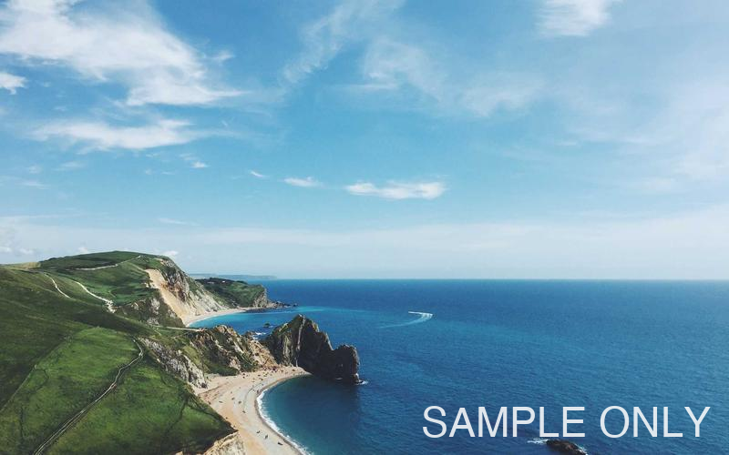
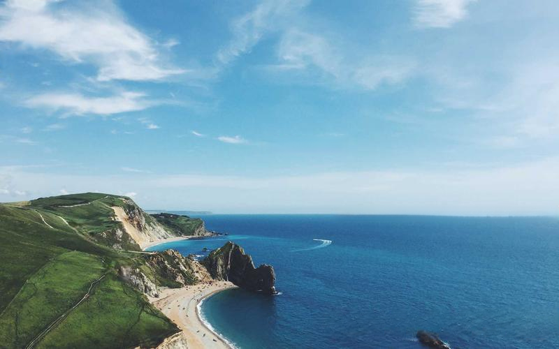
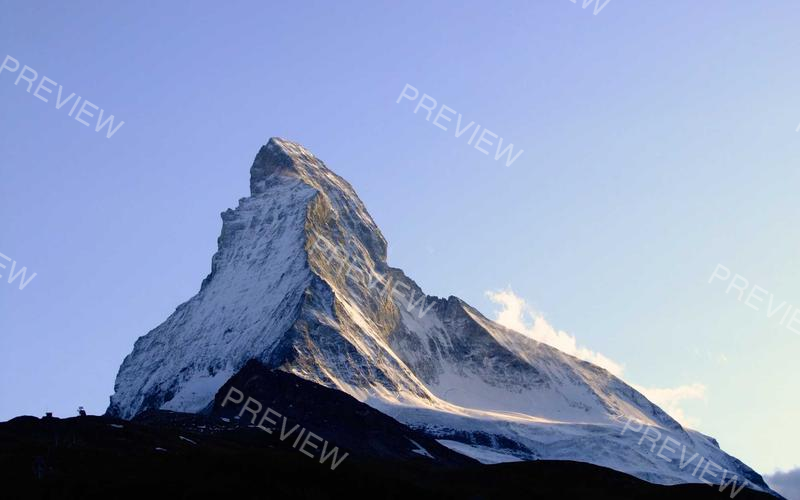

# browser-watermark-removal

**Headless, 100% in-browser watermark removal core.** Detect the watermark, build a glyph-level mask, then inpaint — all on the user's device. No upload, no backend, no UI required.

[Live demo](https://sharksevenro.github.io/browser-watermark-removal/) · [Benchmark](#benchmark) · [Cases](#cases) · [ClearPix](https://clearpix.org) · MIT

[](https://sharksevenro.github.io/browser-watermark-removal/)

```ts
import { removeWatermark, toImageData } from 'browser-watermark-removal';

const image = await toImageData(file);
const result = await removeWatermark(image, {
  quality: 'balanced', // fast | balanced | hq
});

result.image;   // clean ImageData
result.mask;    // what was removed
result.timings; // detect / mask / init / inpaint / total
```

The core is extracted from [ClearPix](https://clearpix.org), the production browser watermark remover and image upscaler. It is designed to be embedded in any canvas app, worker, or editor — including ClearPix itself.

---

## Why this exists

Most browser inpainting tools start with a brush. That is the wrong default for watermarks: the user should not have to trace every glyph, and the model should not have to guess what is watermark vs. texture.

This package does the watermark-specific work before the model:

- **Automatic detection** — PP-OCRv5 text detector plus light-overlay and dark-badge heuristics. Optional YOLO11 second opinion.
- **Glyph-level masks** — text boxes grow a mask from the detector's probability map, so only the strokes are replaced, not the whole rectangle.
- **Shape refinement** — guided-filter shape snapping for solid logos and badges, with a rectangle fallback when the candidate is unreliable.
- **Backend routing** — classical push-pull fill for small/simple masks, MI-GAN for the normal path, LaMa for large/complex holes.
- **Browser-native runtime** — ONNX Runtime Web with WebGPU first and WASM fallback, model caching in IndexedDB, SHA-256 verification, and a runtime-origin race for the WASM binaries.
- **No UI lock-in** — `ImageData` in, `ImageData` out, plus timings and a mask.

## Quick start

```bash
npm install browser-watermark-removal onnxruntime-web
```

> The source and demo are ready; the first npm publication and GitHub Pages
deployment happen when the repository is pushed. Until then, run the demo with
`npm install && npm run dev` from a clone.

```ts
import {
  configureCore,
  removeWatermark,
  toImageData,
} from 'browser-watermark-removal';

configureCore({
  // Host the models yourself, or use the ClearPix demo origin.
  modelBase: 'https://static.clearpix.org',
  ortWasmPaths: 'https://static.clearpix.org/ort/1.30.0/',
});

const image = await toImageData(fileOrUrlOrBlob);
const result = await removeWatermark(image, {
  quality: 'balanced',
  onProgress: (p) => console.log(p.stage, p.done, p.total),
  onStage: (stage) => console.log(stage),
});

const blob = await toBlob(result.image);
```

`onnxruntime-web` is a peer dependency. Models are **not** bundled in the npm package; the default relative paths are `models/*.onnx`, so either serve them at that path or set `modelBase`.

### What to host

| File | Size | Required |
| --- | ---: | --- |
| `models/ppocr_v5_mobile_det.onnx` | 4.7 MB | text detection |
| `models/migan_fp16.onnx` | 14.8 MB | MI-GAN fast path (WebGPU) |
| `models/migan.onnx` | 29.5 MB | MI-GAN fallback |
| `models/lama_fp16.onnx` | 107.8 MB | LaMa HQ path |
| `models/lama_fp32.onnx` | 208 MB | LaMa fallback |
| `models/yolo11_watermark_det.onnx` | 11 MB | optional YOLO |
| `ort/1.30.0/*` | — | ONNX Runtime wasm binaries |

The demo uses `https://static.clearpix.org` so the GitHub Pages build does not ship hundreds of MB of weights. You can copy the files to your own CDN; keep the same names.

## API

### `removeWatermark(image, options?)`

| Option | Type | Default | Notes |
| --- | --- | --- | --- |
| `quality` | `'fast' \| 'balanced' \| 'hq'` | `'balanced'` | `fast` can use classical fill; `hq` uses LaMa. |
| `engine` | `'auto' \| 'migan' \| 'lama' \| 'fast-fill'` | `'auto'` | Force a backend. |
| `mask` | `ImageData` | — | Manual mask; skips detection. |
| `boxes` | `Box[]` | — | Manual boxes; skips detection. |
| `region` | `Box` | — | Restrict detection to a region. |
| `useText` | `boolean` | `true` | PP-OCRv5 text detector. |
| `useLight` | `boolean` | `true` | Semi-transparent white overlays. |
| `useDark` | `boolean` | `true` | Solid dark badges. |
| `useYolo` | `boolean` | `false` | Extra ~11 MB detector. See licensing. |
| `autoGate` | `boolean` | `false` | Conservative gate: drops boxes on complex backgrounds. Higher precision, lower recall. |
| `autoArbitrate` | `boolean` | `false` | Extra YOLO pass when heuristics return many boxes. |
| `maxSide` | `number` | — | Cap detector input for low-end devices. |
| `textDetCap` | `number` | `960` | Text detector input cap. |
| `passes` | `1 \| 2` | `2` balanced, `1` fast/hq | MI-GAN passes. |
| `fastFill` | `boolean` | `true` | Allow classical fill when safe. |
| `onProgress` | `(p) => void` | — | Model download / session progress. |
| `onStage` | `(s) => void` | — | Human-readable stage. |
| `onPass` | `(i, total) => void` | — | Inpainting pass progress. |

Returns:

```ts
interface RemoveWatermarkResult {
  image: ImageData;
  mask: ImageData;          // white = removed, transparent = kept
  boxes: Box[];
  removed: boolean;
  engine: 'migan' | 'lama' | 'fast-fill' | 'none';
  backend: string;          // 'webgpu' | 'wasm' | 'classical'
  stats: MaskStats;         // maskFrac, comps, maxCompDim, maxCompAspect
  timings: {
    detectMs: number;
    maskMs: number;
    initMs: number;
    inpaintMs: number;
    totalMs: number;
  };
}
```

Lower-level exports are also available: `detectWatermarks`, `buildGlyphMaskFullRes`, `refineShapeMask`, `initInpainter`, `inpaint`, `fastFillRegion`, and the model/runtime helpers.

## Benchmark

Measured on **Apple M4, macOS 26.6, Chrome 156, 800×500 inputs, MI-GAN, WebGPU**. Model downloads are excluded; the first call also pays session creation. PSNR is computed against the clean reference, restricted to the returned mask.

| Case | Detect | Mask | Inpaint | Total | Region PSNR in → out | Gain |
| --- | ---: | ---: | ---: | ---: | ---: | ---: |
| `text-br-large` | 222 ms | 81 ms | 1,407 ms | **1,719 ms** | 15.46 → 23.55 dB | **+8.09 dB** |
| `text-tr-faint` | 228 ms | 121 ms | 313 ms | **669 ms** | 22.06 → 29.66 dB | **+7.60 dB** |
| `halo-flat-text` | 193 ms | 49 ms | 308 ms | **555 ms** | 25.87 → 49.72 dB | **+23.84 dB** |
| `tiled-med` | 203 ms | 90 ms | 1,629 ms | **1,938 ms** | 27.10 → 30.00 dB | **+2.90 dB** |

<details>
<summary>Headless WASM numbers (CI-safe, no GPU)</summary>

| Case | Detect | Mask | Inpaint | Total | Gain |
| --- | ---: | ---: | ---: | ---: | ---: |
| `text-br-large` | 392 ms | 66 ms | 7,542 ms | 8,007 ms | +8.09 dB |
| `text-tr-faint` | 388 ms | 87 ms | 1,683 ms | 2,164 ms | +7.60 dB |
| `halo-flat-text` | 380 ms | 44 ms | 1,697 ms | 2,124 ms | +23.98 dB |
| `tiled-med` | 389 ms | 81 ms | 8,411 ms | 8,894 ms | +2.87 dB |

Headless Chromium exposes a SwiftShader WebGPU adapter that is much slower than a real GPU, so the CI benchmark forces WASM. Run `npm run bench:gpu` locally for the WebGPU table above.

</details>

**ClearPix internal 12-case suite** (2026-10-21, same core, M4, headless WASM): recall **89.2%**, precision **65.3%**, mask-region PSNR **24.76 dB**, detect **343 ms**, inpaint **1,207 ms** average. The 12-case suite is broader and includes hard logo/tile cases; the four cases above are the ones used for the public before/after gallery.

### Reproduce

```bash
npm run bench       # headless WASM, writes benchmarks/results-wasm.json
npm run bench:gpu   # headed WebGPU, writes benchmarks/results.json + demo data
```

The benchmark script is Playwright + the real demo page. It does not use a mocked inference path.

## Cases

| Input | Removed |
| --- | --- |
|  |  |
|  |  |
|  |  |
|  |  |

These are synthetic watermarks with a known clean reference — not cherry-picked stock photos. The images are in [`demo/public/cases`](demo/public/cases) and are served by GitHub Pages.

**Known hard cases:** dense city texture behind text, dark logo badges with complex interior detail, and very large repeating overlays. Auto mode can leave residue or over-smooth those. Use a manual `region`/`boxes`/`mask` and the `hq` preset, or a tighter box. The package returns the mask and boxes so your UI can let the user correct them.

## Compared with inpaint-web

[inpaint-web](https://github.com/lxfater/inpaint-web) is the project that proved browser inpainting could work well. It deserves the credit for the WebGPU + WASM inpainting path. This package uses the same model family and runtime foundation, but solves a different problem:

| | inpaint-web | browser-watermark-removal |
| --- | --- | --- |
| Primary interface | Manual mask editor | Headless `ImageData` API |
| Watermark detection | You draw the mask | Text / light / dark detection + optional YOLO |
| Mask quality | Brush | Glyph growth + shape refinement + rectangle fallback |
| Backend routing | Inpainting-first | Fast-fill → MI-GAN → LaMa |
| Output | App | Pixels + mask + boxes + timings |
| Integration | Fork the app | `npm install` and call one function |

We do **not** claim a model-level win over inpaint-web. The difference is the watermark-specific front half and the fact that this is a library, not an editor. If you want a manual-mask editor, use inpaint-web. If you want to add watermark removal to an existing product, start here.

## How it works

```text
ImageData
  │
  ├─ detectWatermarks()
  │    ├─ PP-OCRv5 mobile text detector
  │    ├─ light-overlay heuristic (bright / low-saturation / local contrast)
  │    ├─ dark-badge heuristic (solid dark rounded rectangles)
  │    └─ optional YOLO11 watermark detector
  │
  ├─ buildMask()
  │    ├─ glyph mask from text probability map (full resolution, capped)
  │    ├─ guided-filter shape refinement for solid boxes
  │    ├─ rectangle fallback when the candidate is empty/unreliable
  │    └─ 2 px dilation
  │
  ├─ route
  │    ├─ fast-fill: small mask + simple ring + low area
  │    ├─ MI-GAN: normal path, two-pass coarse-to-fine tiles
  │    └─ LaMa: large/complex holes, single pass, tiled
  │
  └─ ImageData + mask + timings
```

The inpainting layer keeps ClearPix's production lessons: tile planning by connected component, negative-gain guard, cluster masks, proportional paste, and a WebGPU → WASM runtime fallback. The detection layer is intentionally conservative about *false positives* but the package defaults `autoGate` to `false` so recall is not silently sacrificed; turn it on if your product prefers precision.

## Development

```bash
npm install
npm run dev        # demo at http://127.0.0.1:5173
npm run typecheck
npm run build      # library → dist/
npm run build:demo # static demo → demo/dist/
```

The demo is plain TypeScript + Vite. No React, no framework. The library build is `tsup` ESM + `.d.ts`; `onnxruntime-web` stays external and is loaded dynamically.

### Deploy the demo

The workflow in [`.github/workflows/pages.yml`](.github/workflows/pages.yml) builds `demo/dist` and deploys it to GitHub Pages on every push to `main`.

1. Create `SharksevenRo/browser-watermark-removal` on GitHub.
2. Push this repository.
3. Settings → Pages → Build and deployment → **GitHub Actions**.
4. The demo will be at `https://sharksevenro.github.io/browser-watermark-removal/`.

## Model licenses

The library code is MIT. Model weights are **not** bundled and keep their own licenses:

- **PP-OCRv5** — PaddleOCR, Apache-2.0.
- **MI-GAN** — code MIT; weights have a separate `LICENSE-WEIGHTS` in the [Picsart MI-GAN repo](https://github.com/Picsart-AI-Research/MI-GAN). Review it before commercial redistribution.
- **LaMa** — Apache-2.0 ([Carve/LaMa-ONNX](https://huggingface.co/Carve/LaMa-ONNX)).
- **YOLO11** — Ultralytics models are AGPL-3.0 by default. The optional YOLO path is **off by default** and its weights are not included. If you enable it, comply with AGPL-3.0 or obtain an Ultralytics enterprise license.

If you are embedding this in a commercial product, the safest default path is PP-OCRv5 + MI-GAN + LaMa with `useYolo: false`.

## ClearPix

This core is extracted from [**ClearPix**](https://clearpix.org) — a browser-based watermark remover and image upscaler. ClearPix is the production reference consumer: same detection philosophy, same inpainting pipeline, plus the editor, presets, batch flow, and video tools.

If you want the finished product rather than the library, try ClearPix. If you want to build your own, this is the core. Integration notes for ClearPix-style apps are in [`docs/INTEGRATION.md`](docs/INTEGRATION.md).

## License

MIT © 2026 SharksevenRo. See [LICENSE](LICENSE).
